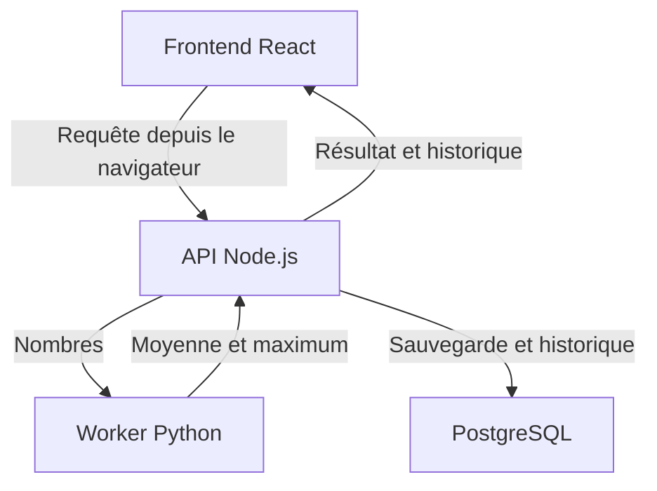
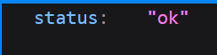
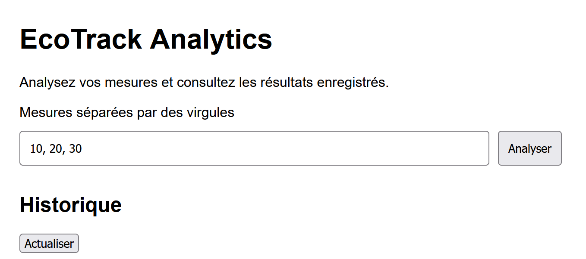
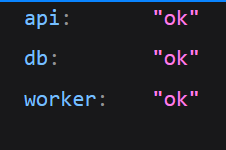
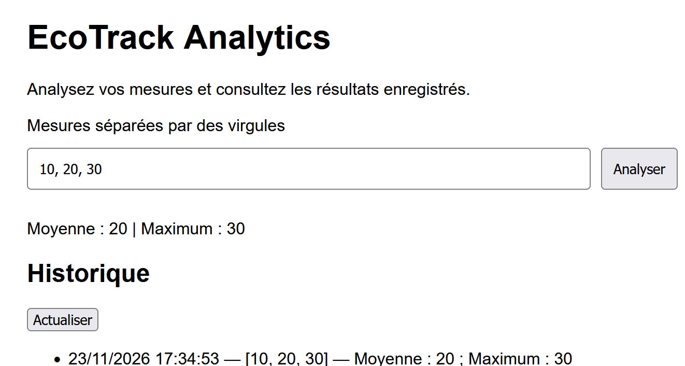
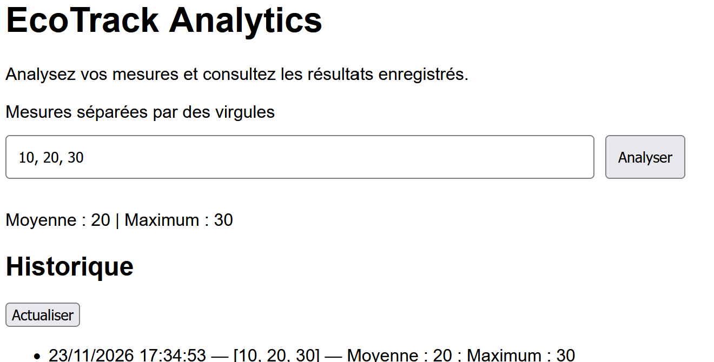
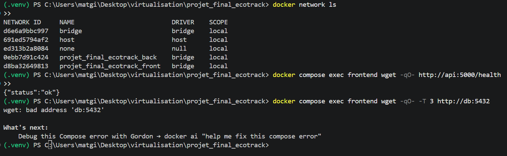
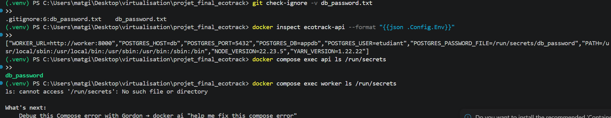

# EcoTrack Analytics

Une organisation souhaite analyser des séries de mesures et conserver les résultats. Depuis une page React, l’utilisateur lance un calcul. L’API Node.js demande au service Python de calculer la moyenne et le maximum, puis enregistre le résultat dans PostgreSQL. La page affiche le résultat et l’historique.



Le JavaScript React s’exécute dans le navigateur. Le conteneur frontend sert les fichiers de la page. Le navigateur appelle localhost:5000 ; dans Docker, l’API contacte worker et db par leur nom de service.

## Votre mission

### 1. Identifier les services

| Dossier ou service | Technologie | Commande de lancement | Port |
|---|---|---|---|
| frontend | React et serveur Node.js | npm run build puis npm start | 3000 |
| api | Node.js Express | npm start | 5000 |
| worker | Python Flask | python app.py | 8000 |
| db | Image postgres:15-alpine | À configurer dans Compose | 5432 interne |


### 2. Tester Python avec un venv

Windows PowerShell :

```powershell
py -m venv .venv
.\.venv\Scripts\Activate.ps1
```

Linux ou macOS :

```bash
python3 -m venv .venv
source .venv/bin/activate
```

Puis :

```bash
python -m pip install -r requirements.txt
python -c "import sys; print(sys.executable)"
python app.py
```

Le chemin Python doit contenir .venv. Ouvrir http://localhost:8000/health : résultat attendu {"status":"ok"}.


### 3. Créer les images

### 4. Configurer Compose

### 5. Ajouter le secret

### 6. Lancer et vérifier

À la racine, après création des fichiers Docker :

```bash
docker compose config -q
docker compose up -d --build
docker compose ps -a
```

Ouvrir http://localhost:3000 pour l’interface et http://localhost:5000/status pour vérifier les trois services backend.


Si nécessaire :

```bash
docker compose logs api
docker compose logs worker
docker compose logs db
docker compose logs frontend
```

### 7. Compléter le dépôt et remettre

Inclure le code fourni, les trois Dockerfiles, les .dockerignore, compose.yaml, requirements.txt, .gitignore et ce README complété.

Ajouter ici :

- Les noms du binôme et le groupe.
- Vos commandes de lancement et d’arrêt.
- Vos preuves : commande ou action, résultat observé et explication.
- Les vérifications du calcul, de la persistance, des réseaux et du secret.

Exclure db_password.txt, .env, .venv et node_modules. Après un nouveau clonage, un lecteur doit pouvoir recréer le secret et démarrer l’application.

Déposer le lien du dépôt GitLab dans le devoir Moodle avant l’échéance annoncée. Donner accès à l’enseignante.

### Endpoints fournis

| Service | Méthode et chemin | Rôle |
|---|---|---|
| worker | GET /health | Vérifier Python |
| worker | POST /analyze | Recevoir {"numbers":[10,20,30]} et calculer |
| api | GET /health | Vérifier le processus Node.js |
| api | GET /status | Vérifier PostgreSQL et worker |
| api | POST /analyze | Calculer via Python et enregistrer |
| api | GET /history | Lire les 50 derniers résultats |

___

### GROUPE : Julien SAUGUES--EYRAUD et Mathis GILGENKRANTZ (A1)
___

### ### COMMANDES DE LANCEMENT ET D'ARRÊT
___

Toutes les commandes doivent être exécutées depuis la racine du projet.

**Créer le secret (à faire une seule fois après le clonage) :**

Le fichier `db_password.txt` n'est pas dans le dépôt, il faut le recréer avant le premier lancement.

Windows PowerShell :
```

Linux ou macOS :
```bash
printf '%s' 'VotreMotDePasse' > db_password.txt
```

**Vérifier la configuration :**
```bash
docker compose config -q
```

**Construire les images et démarrer les services :**
```bash
docker compose up -d --build
```

**Vérifier l'état des conteneurs :**
```bash
docker compose ps -a
```

**Consulter les logs :**
```bash
docker compose logs api
docker compose logs worker
docker compose logs db
docker compose logs frontend
```

**Arrêter les services :**
```bash
docker compose down
```

Les données PostgreSQL sont conservées dans un volume Docker et restent disponibles après l'arrêt des conteneurs.

**Arrêter et supprimer les données :**
```bash
docker compose down -v
```

Attention, l'option `-v` supprime aussi le volume, donc tout l'historique est perdu. Il faut aussi l'utiliser si on change le mot de passe dans `db_password.txt`, sinon PostgreSQL garde l'ancien.

### PREUVES
___

**1. Test de l'environnement Python avec un venv**




**2. Vérification du frontend**



L'interface React est accessible depuis le navigateur à l'adresse http://localhost:3000.

**3. Vérification des services backend**



L'endpoint `/status` permet de vérifier la communication entre l'API, le worker Python et PostgreSQL.

### VÉRIFICATIONS
___

**1. Vérification du calcul**

Une requête POST `/analyze` est envoyée avec les données suivantes :

```json
{
  "numbers": [10, 20, 30]
}
```

Résultats attendus :
- Moyenne : 20
- Maximum : 30

L'API transmet les nombres au worker Python, récupère les résultats et les enregistre dans PostgreSQL.

Voilà le résultat sur l'interface React : 

**2. Vérification de la persistance**

Après avoir effectué plusieurs calculs, l'endpoint GET `/history` permet de consulter les résultats enregistrés.

Les conteneurs sont ensuite arrêtés puis redémarrés avec Docker Compose.

Le volume PostgreSQL permet de conserver les résultats même après la suppression des conteneurs.

Voilà le résultat sur l'interface React après avoir arreté puis redémarré les conteneurs (docker compose down puis docker compose up -d) : 

**3. Vérification des réseaux**

Les services sont répartis sur deux réseaux Docker : `front` (frontend, api) et `back` (api, worker, db).

Commande :
```bash
docker network ls
```
Résultat : on voit les réseaux `projet_final_ecotrack_front` et `projet_final_ecotrack_back` créés par Compose.

Commande (le frontend peut joindre l'API) :
```bash
docker compose exec frontend wget -qO- http://api:5000/health
```
Résultat : `{"status":"ok"}`. Le frontend et l'API sont sur le même réseau `front`.

Commande (le frontend ne peut pas joindre la base) :
```bash
docker compose exec frontend wget -qO- -T 3 http://db:5432
```
Résultat : `wget: bad address 'db:5432'`. Le frontend n'est pas sur le réseau `back`, il ne connait même pas le nom `db`. Seule l'API fait le lien entre les deux réseaux.

L'API utilise les noms de services pour communiquer avec les autres conteneurs :
- `worker:8000` pour le service Python.
- `db:5432` pour PostgreSQL.

Voilà le résultat : 

**4. Vérification du secret**

Le mot de passe PostgreSQL est stocké dans le fichier `db_password.txt`, qui est transmis aux conteneurs grâce au mécanisme des secrets de Docker Compose.

Commande (le fichier n'est pas versionné) :
```bash
git check-ignore -v db_password.txt
```
Résultat : la commande affiche la ligne du `.gitignore` qui exclut `db_password.txt`, il ne sera donc jamais poussé sur GitLab.

Commande (le mot de passe n'est pas dans les variables d'environnement) :
```bash
docker inspect ecotrack-api --format "{{json .Config.Env}}"
```
Résultat : on voit seulement `POSTGRES_PASSWORD_FILE=/run/secrets/db_password`, le chemin du fichier et pas le mot de passe.

Commande (seuls db et api ont accès au secret) :
```bash
docker compose exec api ls /run/secrets
docker compose exec worker ls /run/secrets
```
Résultat : l'API affiche `db_password`, alors que pour le worker on a une erreur `No such file or directory`. Le worker n'a pas besoin du mot de passe donc il n'y a pas accès.

Voilà le résultat : 
